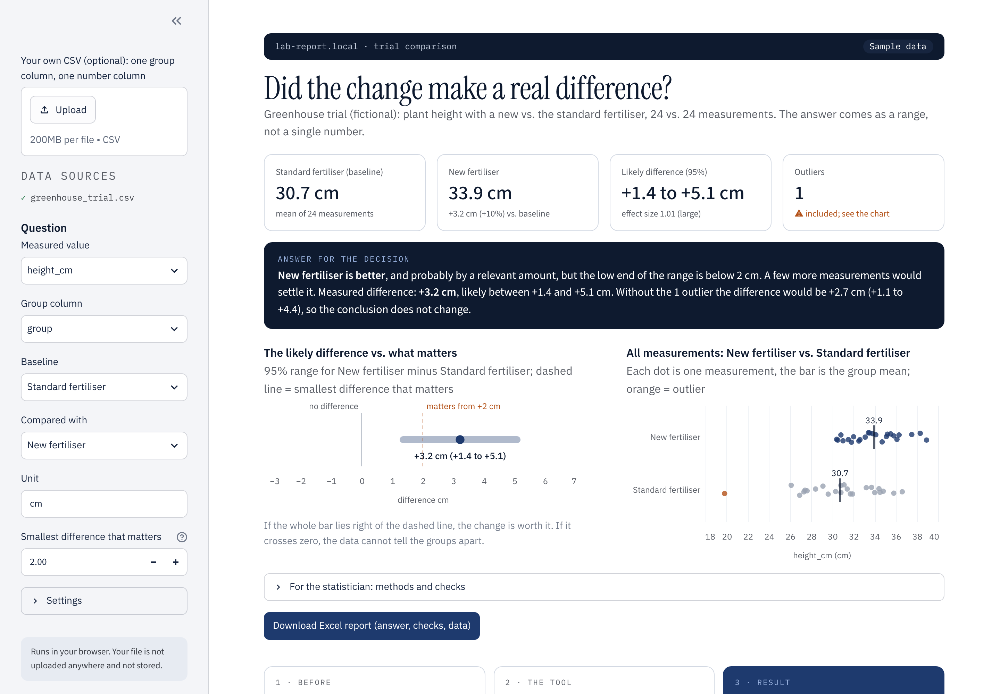

# Did the change make a real difference? (demo)

Compares two groups of measurements (before/after, old/new, A/B) and explains the result in plain language, with an honest range instead of a single number.

**Try it in your browser:** https://dataphil.dev/demo/measurement-stats/ (no install, first load takes 20–40 seconds; your file stays in your browser)



The included sample (`data/greenhouse_trial.csv`) is a made-up greenhouse trial: plant height with a new vs. the standard fertiliser, 24 plants each, one damaged plant as an outlier.

## What it does

- A plain answer (better / not proven / real but too small), judged against the smallest difference that matters to you
- Difference of the means with a confidence interval (Welch t-test) and a bootstrap interval as a cross-check
- Effect size (Cohen's d) so "significant" is not mistaken for "important"
- Rank-based test (Mann-Whitney U) and a normality check, with a warning when they disagree
- Outlier flag (1.5 × IQR) with a switch to see how much the outliers change the result
- One-paragraph conclusion a non-statistician can read, and an Excel report with result, summary and data

Works with any CSV that has one group column and one number column.

## Run it locally

Windows: double-click `start-windows.bat`
Mac / Linux: double-click `start-mac-linux.command` (Mac: right-click > Open the first time)

Or with Python 3.10+:

```bash
pip install -r requirements.txt
streamlit run app.py
```

## Note

This is a demo of the approach, not a replacement for thinking about the study design. In a client project the first step is always to check how the data were collected (randomisation, repeated measurements, batches) and to choose the method to match.

`docs/index.html` is the browser version, built with [stlite](https://github.com/whitphx/stlite).

## About

Built by DataPhil: Excel and CSV work automated in Python, and data analysed with sound statistics. MIT licence.
